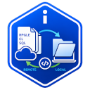

# IBMi Source Member Checkout

<p>
  
</p>

Check out IBM i source members locally, edit them offline, and merge changes back using VS Code's built-in diff editor. Works with [Code for IBM i](https://marketplace.visualstudio.com/items?itemName=HalcyonTechLtd.code-for-ibmi).

## Why?

Editing source members directly through Code for IBM i saves straight to the IBM i on every keystroke-save. This extension lets you **check out a local copy**, work at your own pace, and **merge changes back** when ready — with full diff support and source date preservation. This allows AI tools to work with your source files locally.

## Important
I would go into the settings and change the local folder to a different location than the default. The default is in the extension storage. This just makes finding the folder easier to open in the workspace.

The easiest way is **IBM i Checkout: Move Checkout Folder...** (Command Palette, or the **...** menu on the Checked Out Members panel). It moves any members you've already checked out into the new folder and updates the setting for you. Editing the setting directly only affects new checkouts — existing ones stay where they are.

## Settings
- **Allow Checkout From Protected Filter** - allows you to check out a member from a protect object browser filter
- **Auto Open On Checkout** - automatically open the downloaded source member when checking out
- **Local Folder** - what folder to store the checked out member to. (It's recommended to change this to another folder — use **Move Checkout Folder...** to bring existing checkouts along).
- **Warn On Redownload** - what that the member has already been checked out before overwriting it.

## Features

### Check Out Members

Right-click a member in the Code for IBM i Object Browser and choose **Check Out Member**. The source downloads to a local file (named after the member, e.g. `EXAMPLE.RPGLE`, for correct compilation) organized by system, library, and source file, and shows up in the **Checked Out Members** panel.

Select multiple members (Ctrl/Shift-click) before checking out, and they're all downloaded together — if any are already checked out, you're asked once whether to re-download or skip them.

### Checked Out Members Panel

Hover over a checkout to see its member text, status, checkout dates and local path. Member text is recorded at checkout, and checkouts made before it was recorded pick it up on their next refresh.

Checkouts are grouped **Library → Source File → Member**. Libraries and source files start collapsed; use **Expand All** in the panel toolbar to open everything, or search by member name to show only the matching members, already expanded.

```
MYLIB
  QRPGLESRC
    PAYROLL.RPGLE
  QCLSRC
    PAYROLLC.CLLE
```

### Check Out All Members

Right-click a **source file** (one level above members) and choose **Check Out All Members** to pull down every member it contains in one go. Since this can mean a lot of members, a confirmation dialog warns that it may take a while before starting.

### Protected Filter Members

Checkout is hidden by default for members in a protected (read-only) filter. Enable `ibmi-checkout.allowCheckoutFromProtectedFilter` to allow it when you deliberately want a local working copy of a protected source.

### Merge Back to IBM i

Right-click a checkout and choose **Merge Back to IBM i** to open a diff view — your local changes on the left, the live remote member on the right. Use VS Code's merge arrows to selectively apply changes, then save the remote side; Code for IBM i handles the upload and **preserves source dates**.

### Upload to IBM i

For a quick full replace, use **Upload to IBM i**. This overwrites the remote member with your local copy. A warning confirms that **source dates will not be preserved**. If any lines are longer than the source file's record length allows, the confirmation lists them, since they would be cut off.

### New Members (Files Created Locally)

If a file is created in the checkout folder outside the extension (by hand, by a tool, or by an AI assistant), for example `checkouts/myhost/MYLIB/QRPGLESRC/NEWMBR.RPGLE`, it can be added to your checkouts and created on the IBM i:

- **Scan for New Local Files...** (panel **...** menu or Command Palette) lists files in the checkout folder that aren't checked out. The library, source file, member name and type come from the folder and file names. Pick the ones to add.
- Turn on `ibmi-checkout.watchForNewFiles` (off by default) to have new files noticed as they appear, with an offer to add them.
- Added files show with a blue **+** icon as **new — not on the IBM i yet**. Right-click and choose **Create on IBM i** (also an inline icon) to run `ADDPFM` with the source type taken from the file extension, then upload the content. It works on a multi-selection too.
- If the source file doesn't exist on the IBM i, nothing is created. If the member was created on the IBM i in the meantime, it isn't overwritten: refresh shows it as a conflict so you can use Merge Back.
- Member names must be 1-10 characters and can't start with a digit. Other characters are left for the IBM i to accept or reject, since valid characters depend on the system's CCSID. Members are created with blank text.

**Create on IBM i** is also offered for members flagged **Remote member does not exist**, to put them back on the IBM i.

If a file for a member whose checkout shows **Local file missing** turns up in the checkout folder (for example you changed its extension or moved it back), the scan offers to re-link that checkout to it. Its checkout history is kept, so the next refresh compares it properly.

### Missing Local Files

Opening a checkout whose local file is missing (double-click, **Open Local File**, or a refresh) offers:

- **Restore from Open Editor** — if the file's contents are still open in an editor tab (VS Code keeps them after a rename or delete), save them back to the checkout location
- **Re-checkout from IBM i** — download the member again (not offered for new members that were never on the IBM i)
- **Remove from Checkouts** — stop tracking it

### Re-checkout from IBM i

Right-click a checkout and choose **Re-checkout from IBM i** to replace your local copy with a fresh download of the remote member, without having to refresh first. This discards any local changes, so a confirmation dialog is shown before proceeding. Works on a multi-selection.

### Refresh Remote Status

Compares your local file, the live remote content, and the remote content as it was at checkout time (not just a stale comparison) to classify each checkout:

- **In sync** — local matches remote exactly
- **Modified** — you've edited locally; remote is unchanged (safe — nothing to lose)
- **Conflict** — remote changed *and* still differs from local (re-checkout would discard your edits — review with Merge Back first)
- **Remote member does not exist** — the member was deleted or renamed on the IBM i (shown with a red error icon); your local copy is the only one left
- **Local file missing** — the local file was renamed, moved or deleted outside the extension (shown with a red slashed-circle icon). The IBM i isn't contacted for these, and nothing is removed from your checkouts automatically; if the file comes back (for example a drive is reconnected), the next refresh picks it up again

Trailing blank lines (including lines that contain only blank padding) are ignored when comparing, so extra blank lines at the end of a member don't make it look out of sync.

Refresh per member (inline icon or context menu, with a conflict prompt to Merge Back or Re-checkout), per source file, per library, or for every checkout at once from the panel toolbar. Members are refreshed in the order the panel shows them, and the progress notification shows which member is being checked.

### Compare With

Right-click a checkout for comparison tools: **Select for Compare** (mark one checkout, then **Compare with Selected** on another), **Compare with Active File**, **Compare with Local File**, **Compare with IFS File**, or **Compare with Member** (any source member by path).

### Other Actions

- **Open Local File** / **Open Remote File** — open either copy in the editor
- **Run Action** — trigger Code for IBM i's local source actions (compile, deploy, etc.)
- **Reveal in File Explorer** — show the local file in your OS file manager
- **Copy Member Path** — copy `LIBRARY/SOURCEFILE(MEMBER)` to the clipboard
- **Move Checkout Folder...** — choose a new local folder; existing checkouts are moved there, the index is updated, and the Local Folder setting is changed (panel **...** menu or Command Palette)
- **Discard Checkout** — delete the local file and stop tracking it (with confirmation)

### Multi-Select

The Checked Out Members panel supports selecting multiple checkouts at once. **Open Local/Remote File, Run Action, Upload to IBM i, Create on IBM i, Re-checkout from IBM i, Refresh Remote Status,** and **Discard Checkout** all work on a multi-selection, each confirming with a message naming how many members the action will affect before proceeding. Actions that only make sense for one item at a time (Merge Back, Compare With, Copy Member Path, Reveal in File Explorer) are single-selection only.

## Settings

| Setting | Default | Description |
|---------|---------|-------------|
| `ibmi-checkout.localFolder` | *(empty)* | Custom folder for checked-out files. Leave empty to use extension storage. The folder is created automatically on the first checkout. Use **Move Checkout Folder...** to move existing checkouts along with it. |
| `ibmi-checkout.warnOnRedownload` | `true` | Show warning when checking out a member that is already checked out. |
| `ibmi-checkout.autoOpenOnCheckout` | `true` | Automatically open the file in the editor after a single-member checkout. |
| `ibmi-checkout.allowCheckoutFromProtectedFilter` | `false` | Allow checking out members from protected (read-only) filters. |
| `ibmi-checkout.watchForNewFiles` | `false` | Watch the checkout folder for new files created outside the extension and offer to add them to your checkouts. |

## Local File Structure

```
checkouts/
  myhost.company.com/
    MYLIB/
      QRPGLESRC/
        PAYROLL.RPGLE
      QCLSRC/
        PAYROLLC.CLLE
```

Organizing by system, library, and source file preserves the original filename for compilation and prevents collisions across different IBM i systems.

## Requirements

- [Code for IBM i](https://marketplace.visualstudio.com/items?itemName=HalcyonTechLtd.code-for-ibmi) v3.0.0 or later
- Active connection to an IBM i system

## License

GPL-3.0
